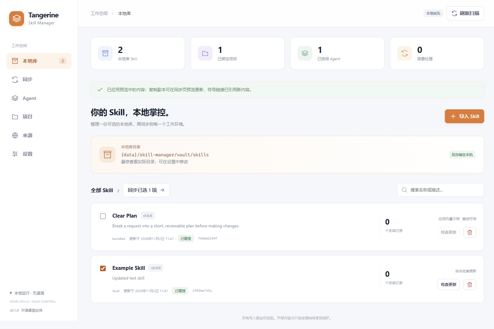
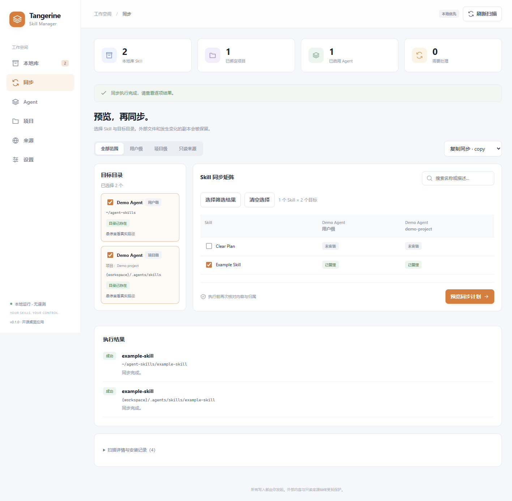

# Tangerine Skill Manager

**一份 Skill 库，管理多个 AI Agent 的使用目录。同步前预览，遇到冲突保留原文件。**

如果你已经在 Codex、Claude Code、Cursor 等工具中使用 `SKILL.md`，也遇到过“同一份 Skill 到处复制、改过之后不知道哪些副本需要更新”，这个桌面工具就是为此准备的。

**Windows 优先 · 中文界面 · 本地存储 · 无账号、无遥测 · GPL v3**

[开始使用](#开始使用) · [首次同步](#完成第一次同步) · [常见问题](docs/FAQ.md) · [反馈问题](https://github.com/Manamiiii/TangerineSkillManager/issues)



*真实 Windows 桌面截图，使用内置示例与虚构测试数据。*

## 为什么使用它

- **集中维护一份库**：从本地目录或公开 Git 仓库导入，查看 Skill 原文、来源、版本和安装记录。
- **同步到不同工作环境**：按需选择 Agent 用户级目录或项目级目录，支持复制和链接模式。
- **写入前看清变化**：先预览新增、更新、跳过与冲突，再执行；未知目录、外部链接和手动修改过的副本会被保留。
- **更新有依据**：来源更新可预览文件变化，库内容和已安装副本的更新分开确认。

典型流程：**本地目录 / 公开 Git → 本地库 → 预览同步 → Agent 或项目目录**。

它管理文件和安装记录，不运行 Agent。只使用一个 Agent、很少更新 Skill 时，手工管理目录可能就够了。

## 开始使用

当前是 **0.1.0 试用阶段**，尚无正式发行包。可以从源码运行；以后发行包会放在 [GitHub Releases](https://github.com/Manamiiii/TangerineSkillManager/releases)。

| 平台 | 当前状态 |
| --- | --- |
| Windows x64 | 已在开发机器验证桌面流程及便携程序；尚未完成干净机器验收，产物未签名 |
| macOS / Linux | 已有构建配置；仍需对应平台验证，不承诺已可用 |

源码启动需要 **Node.js 24 LTS 或更新的受支持版本、npm**，以及安装依赖时的公网访问。使用 Git 克隆，或从仓库的 **Code → Download ZIP** 下载源码：

```sh
git clone https://github.com/Manamiiii/TangerineSkillManager.git
cd TangerineSkillManager
npm ci
npm start
```

下载 ZIP 的用户进入解压后的工程目录，从 `npm ci` 开始。`npm start` 会构建并打开桌面窗口。打包后的应用不依赖 Node、Git 或 Agent 专用 CLI。

## 完成第一次同步

1. **导入示例**：在“本地库”点击 **试用内置示例**，导入 `Clear Plan`。这一步不联网，也不会写入 Agent 目录。
2. **添加目标**：进入“Agent”，新建 Agent，先选择一个专用空目录体验；也可以选择常用 Agent 模板并核对目录。
3. **预览并执行**：进入“同步”，选择示例和目标，点击 **预览同步计划**。确认目标及“新增”操作后执行。
4. **验证结果**：目标目录中应出现 `clear-plan/SKILL.md`；再次预览应为“跳过”。试用结束可在“扫描详情与安装记录”中 **卸载副本**。

熟悉后，在“来源”添加自己的本地目录或公开 HTTPS Git 仓库，发现并导入 Skill；需要项目级同步时，在“项目”绑定工程。**导入不会自动同步**。

<details>
<summary>查看同步界面</summary>



</details>

## 支持范围与使用边界

| 能力 | 当前支持 |
| --- | --- |
| Skill 来源 | 本地目录、公开 HTTPS Git 仓库（分支/标签及子目录） |
| Agent 目录 | 可新增、编辑、禁用、排序；内置 Codex、Claude Code、Cursor、GitHub Copilot、Gemini CLI、OpenCode、Cline 可选模板 |
| 同步 | 用户级、项目级、额外目录；copy / symlink（Windows 为 junction）；只读来源仅用于发现 |
| 多市场发现 | GitHub 仓库搜索、实验性 SkillsMP 搜索；skills.sh、ClawHub 仅提供浏览器入口 |
| 更新 | Skill 更新预览；主动查询本仓库 GitHub 发行版，手动下载应用更新 |

- 模板依据目录约定配置，**未逐一验证所有 Agent 会加载或调用 Skill**。详见 [生态支持](docs/ECOSYSTEM.md)。
- 私有 Git、认证、自定义代理、Registry 制品、npm/pip 和自定义 CLI Provider 尚未实现。
- 基础管理与同步可离线使用。Git 获取、市场搜索和版本查询只在主动操作时联网；不会上传 Skill 内容、用户配置或本机路径。
- 默认使用系统 DNS。若网络将公开域名解析到私网/保留地址，连接会被阻止；可选择本地导入，或了解 [可选 HTTPS DNS 及其隐私说明](docs/CONFIGURATION.md#网络连接)。
- 同步保护不代替备份。使用陌生 Skill 前请阅读内容，Agent 执行其中指令的风险不由文件管理工具消除。[安全边界](SECURITY.md)

默认库位于系统用户数据目录下的 `skill-manager/vault/skills`，支持在设置中修改。示例配置使用 `~`、`{data}` 和 `{workspace}`，无需改成作者的本机目录。[配置、迁移与恢复](docs/CONFIGURATION.md) · [常见问题](docs/FAQ.md)

## 开发与参与

使用 Electron + React + TypeScript。Provider、文件系统安全与同步引擎独立于 UI；新增来源不需要改写同步核心。Electron 带来一定包体积，本项目不以极小安装包为目标。

```sh
npm test
npm run build
npm run test:desktop
npm run audit:source
npm run dist
```

`build` 包含类型检查；`dist` 仅在本机生成当前平台产物，不自动发布。测试使用临时目录，不接触真实 Agent 数据。

[开发与跨平台构建](docs/DEVELOPMENT.md) · [架构](ARCHITECTURE.md) · [Provider 扩展](docs/PROVIDERS.md) · [实际验证记录](docs/VALIDATION.md) · [贡献指南](CONTRIBUTING.md) · [行为准则](CODE_OF_CONDUCT.md)

欢迎反馈实际遇到的问题。提交 Issue 时说明系统、应用版本、操作步骤和预期结果；请先遮盖截图、日志中的用户名、个人路径和敏感 Skill 内容。[公开资料隐私检查](docs/PUBLICATION.md)

## License

Copyright (c) 2026 Tangerine Skill Manager contributors.

以分享实用工具为目标，采用 [GNU GPL v3.0（GPL-3.0-only，仅第 3 版）](LICENSE)。允许使用、修改及商业使用；分发本项目及其衍生作品时须遵守 GPL v3 的相应源码、许可证与版权声明要求。软件按原样提供，不作担保。

第三方依赖保留各自许可证，见 [第三方声明](THIRD_PARTY_NOTICES.txt)。用户导入的 Skill 保留其原有许可，不因被本工具管理而改用 GPL。
